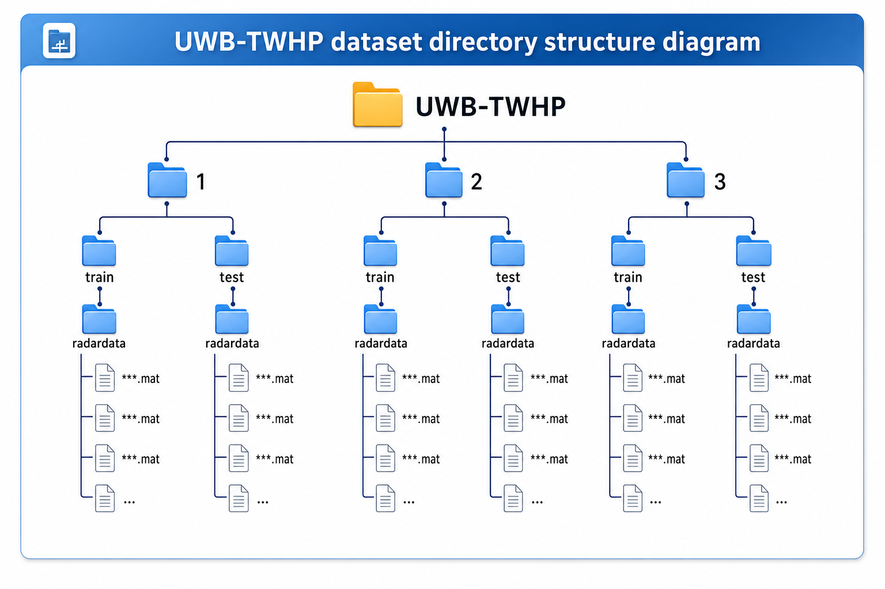
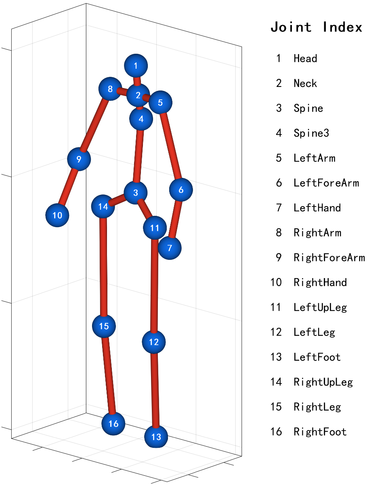
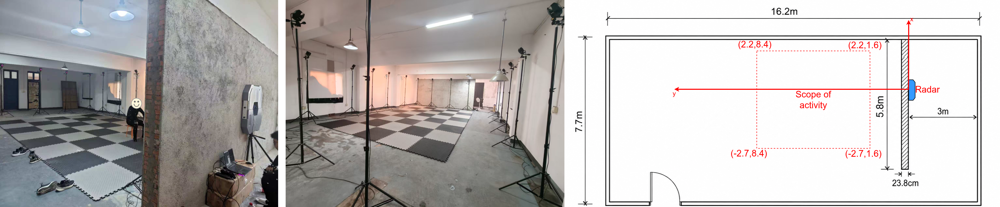
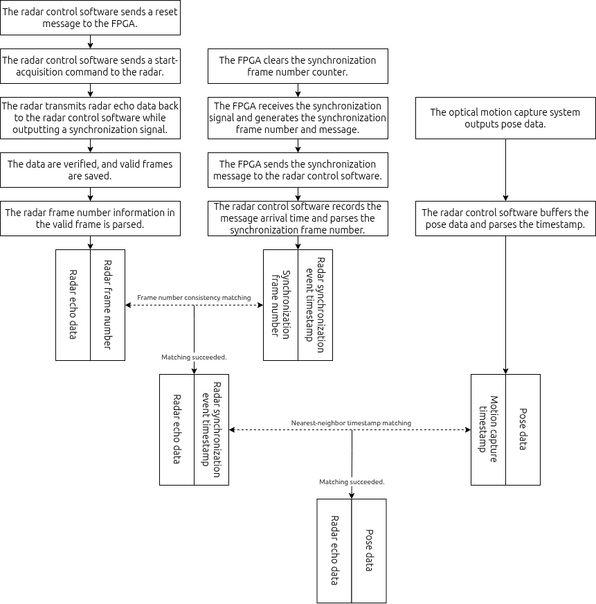
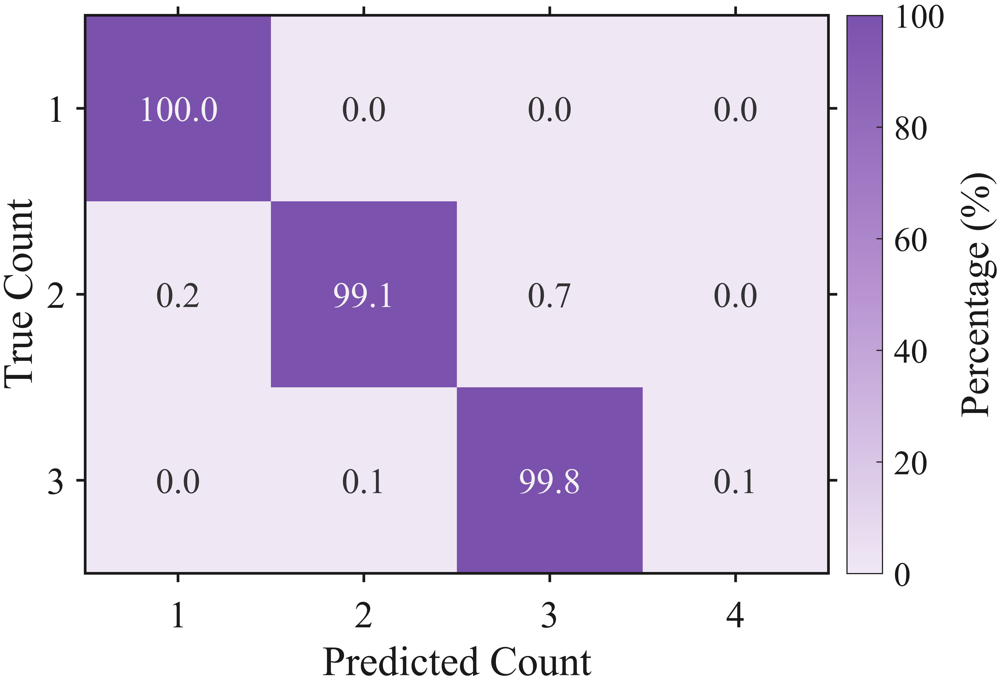

# UWB-TWHP Dataset

English | [简体中文](README_zh.md)

UWB-TWHP is an ultra-wideband radar dataset for through-wall 3D human pose estimation in indoor scenes. The dataset was synchronously collected using a self-developed UWB through-wall radar system and an optical motion capture system. It provides pulse-compressed radar range profiles, synchronized 3D human skeleton labels, and action labels, and can be used for through-wall human pose reconstruction, multi-person sensing, action analysis, and radar signal processing research.

## Dataset Overview

| Item | Description |
| --- | --- |
| Sensor | UWB radar, S-band, 2.5 GHz center frequency, 1 GHz bandwidth, FMCW, 8T8R |
| Reference labels | 3D human skeletons from a NOKOV optical motion capture system |
| Scenario | Indoor through-wall scene with an approximately 23.8 cm thick wall |
| Subjects | 15 volunteers, anonymized as H0-H14 |
| Number of people | One-person, two-person, and three-person scenes |
| Action classes | 8 common human actions |
| Dataset scale | 3,764 `.mat` files and 2,293,076 synchronized radar-pose frames |
| Dataset size | Approximately 524.1 GB |
| File format | MATLAB v7.3 `.mat` |
| Default split | The first 80% frames of each trial are used for training, and the last 20% are used for testing |
| License | CC BY 4.0 |

## Data Access

The dataset is hosted on Science Data Bank (<https://www.scidb.cn/>). After the data upload is complete, the dataset will temporarily remain under an embargo. We will remove the embargo after the dataset paper is accepted by a journal and update the download link here.

> Download link: to be updated

Related code repositories:

- Data post-processing and visualization code: <https://github.com/Toby154/UWB-TWHP_Post-processing.git>
- Baseline training, testing, and visualization code: <https://github.com/Toby154/UWB-TWHP_baseline.git>

## Directory Structure

The dataset is organized by the number of people and the train/test split:

```text
UWB-TWHP/
├── 1/
│   ├── train/radardata/*.mat
│   └── test/radardata/*.mat
├── 2/
│   ├── train/radardata/*.mat
│   └── test/radardata/*.mat
└── 3/
    ├── train/radardata/*.mat
    └── test/radardata/*.mat
```



`1`, `2`, and `3` denote one-person, two-person, and three-person scenes, respectively.

## File Naming Rules

One-person scene:

```text
N1_Hh_Aa_Cc_train.mat
N1_Hh_Aa_Cc_test.mat
```

Two-person scene:

```text
N2_Hh1-h2_Aa1-a2_Cc_train.mat
N2_Hh1-h2_Aa1-a2_Cc_test.mat
```

Three-person scene:

```text
N3_Hh1-h2-h3_Aa1-a2-a3_Cc_train.mat
N3_Hh1-h2-h3_Aa1-a2-a3_Cc_test.mat
```

Naming fields:

- `N1`, `N2`, `N3`: number of people in the scene.
- `H`: subject ID. For example, `H0-1` denotes subjects H0 and H1.
- `A`: action ID. For example, `A2-3` means the corresponding subjects perform A2 and A3.
- `C`: repeated collection index for the same action or action combination under different positions or paths.
- `train`, `test`: training or testing split.

In multi-person scenes, the subject order strictly corresponds to the action order. For example:

```text
N2_H0-1_A2-3_C1_train.mat
```

This file denotes a two-person scene where subject H0 performs action A2 and subject H1 performs action A3. It is the training file from the first repeated collection.

## Variables in `.mat` Files

Each `.mat` file mainly contains the following variables:

| Variable | Size | Description |
| --- | --- | --- |
| `action` | `n × 1 × f` | Action labels, where `n` is the number of people and `f` is the number of frames |
| `joint` | `n × 48 × f` | 3D human pose labels |
| `conf` | `n × 1 × f` | Target existence confidence label. The value `1` means that the target exists |
| `radar_data_real` | `512 × 64 × f` | Real part of the pulse-compressed radar range profiles |
| `radar_data_imag` | `512 × 64 × f` | Imaginary part of the pulse-compressed radar range profiles |

The second dimension of `joint` has 48 values, representing the 3D coordinates of 16 joints:

- Indices `1-16`: `x` coordinates of the 16 joints;
- Indices `17-32`: `y` coordinates of the 16 joints;
- Indices `33-48`: `z` coordinates of the 16 joints.

Coordinate definitions:

- `x`: azimuth dimension;
- `y`: range dimension;
- `z`: height dimension.

The order of the 16 joints is:

| Index | Joint |
| --- | --- |
| 1 | Head |
| 2 | Neck |
| 3 | Spine |
| 4 | Spine3 |
| 5 | LeftArm |
| 6 | LeftForeArm |
| 7 | LeftHand |
| 8 | RightArm |
| 9 | RightForeArm |
| 10 | RightHand |
| 11 | LeftUpLeg |
| 12 | LeftLeg |
| 13 | LeftFoot |
| 14 | RightUpLeg |
| 15 | RightLeg |
| 16 | RightFoot |



## Action Labels

| Action ID | Numeric label | Action name |
| --- | --- | --- |
| A0 | 0 | Sitting |
| A1 | 1 | Squatting |
| A2 | 2 | Standing |
| A3 | 3 | Punching |
| A4 | 4 | Kicking |
| A5 | 5 | Bending |
| A6 | 6 | Waving |
| A7 | 7 | Walking |

Action labels are derived from the acquisition protocol and directory naming rules. They are not frame-by-frame manual action annotations.

## Python Loading Example

The dataset is stored in MATLAB v7.3 `.mat` files. We recommend using `h5py` in Python:

```python
import h5py

mat_path = "UWB-TWHP/1/train/radardata/N1_H0_A2_C1_train.mat"

with h5py.File(mat_path, "r") as f:
    print(list(f.keys()))

    action = f["action"][:]
    joint = f["joint"][:]
    radar_real = f["radar_data_real"][:]
    radar_imag = f["radar_data_imag"][:]
    radar_complex = radar_real + 1j * radar_imag

print(action.shape)
print(joint.shape)
print(radar_complex.shape)
```

Depending on the environment, arrays loaded from MATLAB v7.3 files may appear in a dimension order that differs from MATLAB. For actual training or visualization, please refer to `dataset.py` in the baseline repository.

## Experimental Environment

The experiment was conducted in an indoor open room with a length of 16.2 m, a width of 7.7 m, and a height of 3.3 m. To build a controllable through-wall sensing scenario, a common red brick wall with a length of 5.8 m and a thickness of 23.8 cm was constructed in the experimental area.

The wall divided the space into a radar operation area and a subject activity area. The radar system and acquisition computer were placed on one side of the wall, while the subjects and the optical motion capture system were placed on the other side. During acquisition, the radar antenna array was placed close to the wall to reduce the free-space propagation distance between the radar and the wall and to improve the observability of human echoes behind the wall.

The subject activity area was equipped with optical motion capture cameras. Floor mats and position markers were used to indicate standing points, motion paths, and activity boundaries. Taking the radar position as the coordinate origin, the subject activity area covered approximately -2.7 m to 2.2 m in the azimuth dimension and 1.6 m to 8.4 m in the range dimension.



## Data Acquisition and Synchronization

The radar recorded through-wall human echoes at 26 Hz, while the motion capture system output 3D skeletons at 100 Hz. To establish frame-level correspondence between radar data and motion capture data, the acquisition system used radar frame numbers, FPGA synchronization pulse counting, and unified software timestamps for online matching.

The synchronization procedure is:

1. The radar control software sends a reset message to the FPGA and sends a start-acquisition command to the radar.
2. The radar starts returning echo data and outputs a synchronization pulse at the beginning of each frame.
3. The FPGA receives the synchronization pulse, generates the synchronization frame number and message, and sends the message to the radar control software through a serial port.
4. The acquisition software parses the radar frame number from the radar echo data and the synchronization frame number from the FPGA synchronization message.
5. The software first binds the radar echo frame to the synchronization event according to frame-number consistency.
6. The optical motion capture system outputs pose data synchronously, and the acquisition software buffers the pose data and parses its timestamp.
7. Because the radar and motion capture systems have different frame rates, the software uses nearest-neighbor timestamp matching to bind each radar frame to the closest 3D human skeleton frame in time.
8. If the nearest-neighbor time difference is smaller than the predefined threshold, the match is considered valid; otherwise, the sample is discarded.



The final saved data only contains valid matched samples, including radar frame numbers, pulse-compressed radar range profiles, matched 3D human skeleton data, and the timestamps of the corresponding pose frames. If packet loss in radar echo data, FPGA serial synchronization messages, or motion capture data prevents frame-number matching or timestamp matching, the sample is not written into the final dataset.

Note that the radar frame timestamp is recorded by the acquisition software when it receives the FPGA serial synchronization message, rather than being generated directly by the FPGA local hardware clock. Therefore, the timestamp may be affected by serial transmission delay and computer system scheduling delay. The dataset reduces this influence through a unified acquisition software clock, frame-number consistency checks, and timestamp threshold constraints.

The released dataset consists of manually checked and post-processed `.mat` files. It does not include raw radar echo files or raw motion capture JSON files.

## Baseline Results

The paper provides a CNN + Transformer baseline for human pose reconstruction. The baseline was trained on the default training split and evaluated on the default test split.


| Metric | Result |
| --- | --- |
| MPJPE | 3.91 cm |
| Miss rate | 0.12% |
| False alarm rate | 0.22% |
| EMR | 99.54% |

EMR denotes the exact match rate, which is the percentage of frames with neither false alarms nor missed detections. The confusion matrix for people-count detection is shown below:



The following figure shows representative 3D pose reconstruction results on test samples. Blue denotes predictions, and red denotes ground truth.


Baseline code, training scripts, testing scripts, trained model files, and visualization tools are available at:

<https://github.com/Toby154/UWB-TWHP_baseline.git>

## Usage Notes

- To reproduce the baseline experiment, use the default train/test split first.
- To evaluate generalization ability, users can rebuild splits across subjects, actions, or numbers of people based on file names.
- In multi-person scenes, the subject order, action order, and the person order in `action` and `joint` must be kept consistent.
- Walking sequences are longer and therefore contain more frames. Pay attention to class distribution when performing action classification or balanced training.

## License

The dataset is shared under the CC BY 4.0 license. The related code is released under the MIT license.

## Citation

If you use this dataset, please cite the corresponding paper and dataset entry. The citation format will be updated here after the paper and dataset are accepted.
