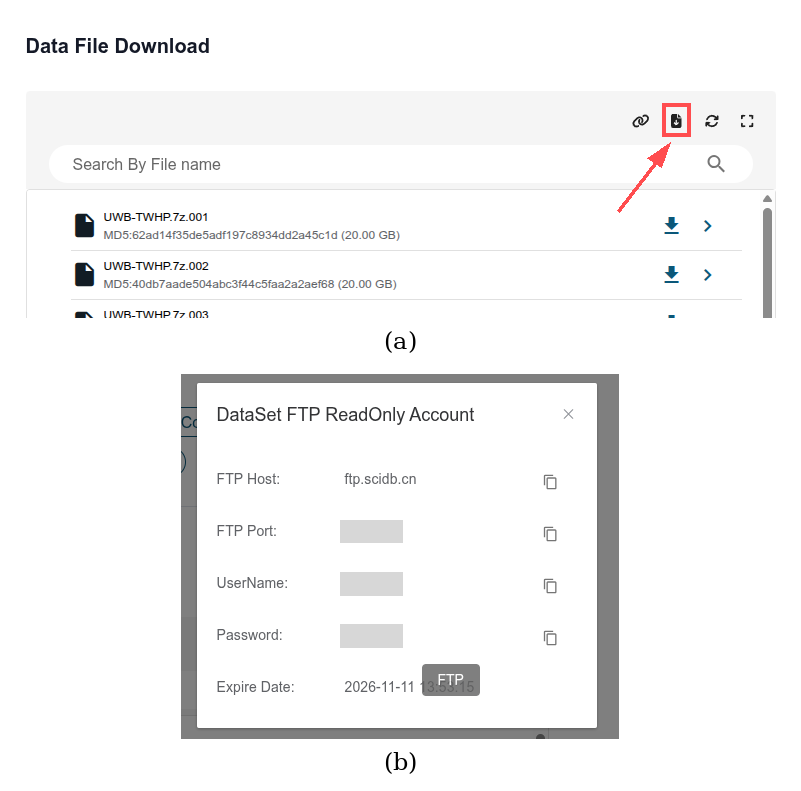
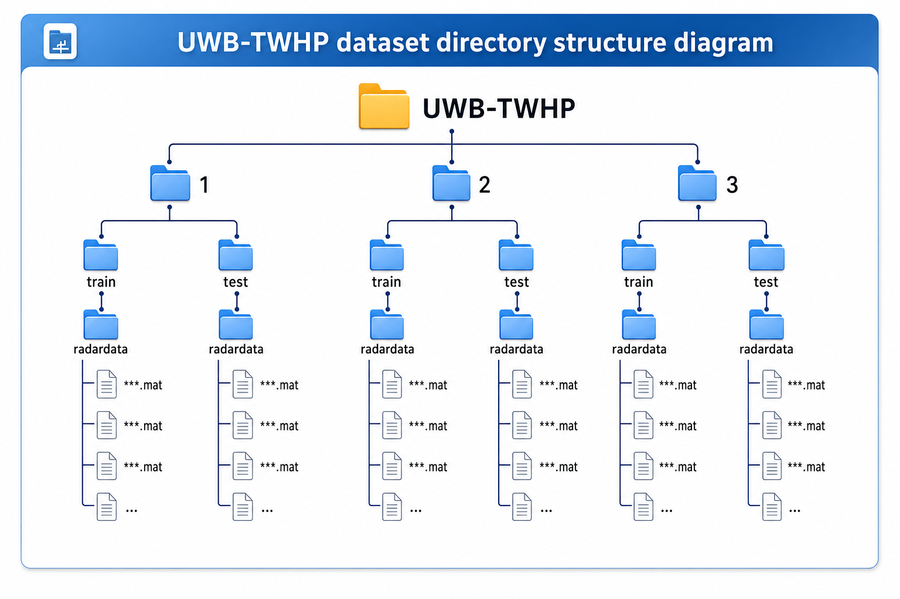
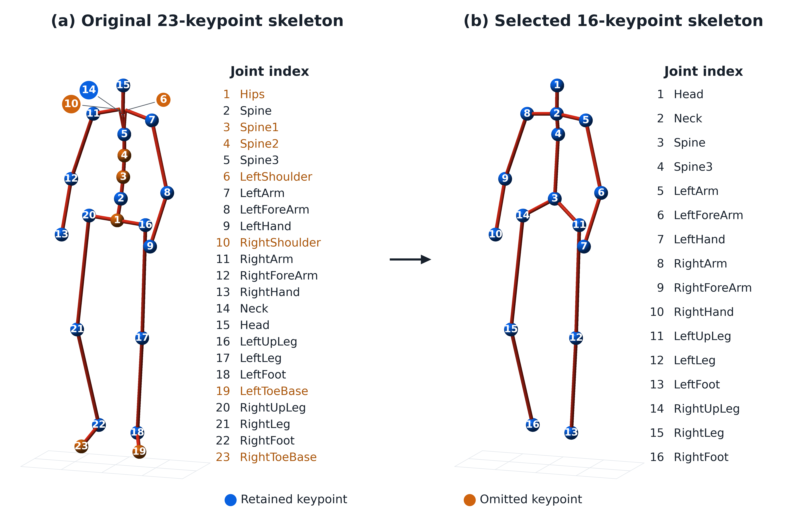
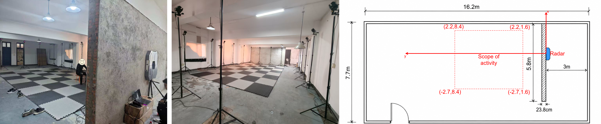
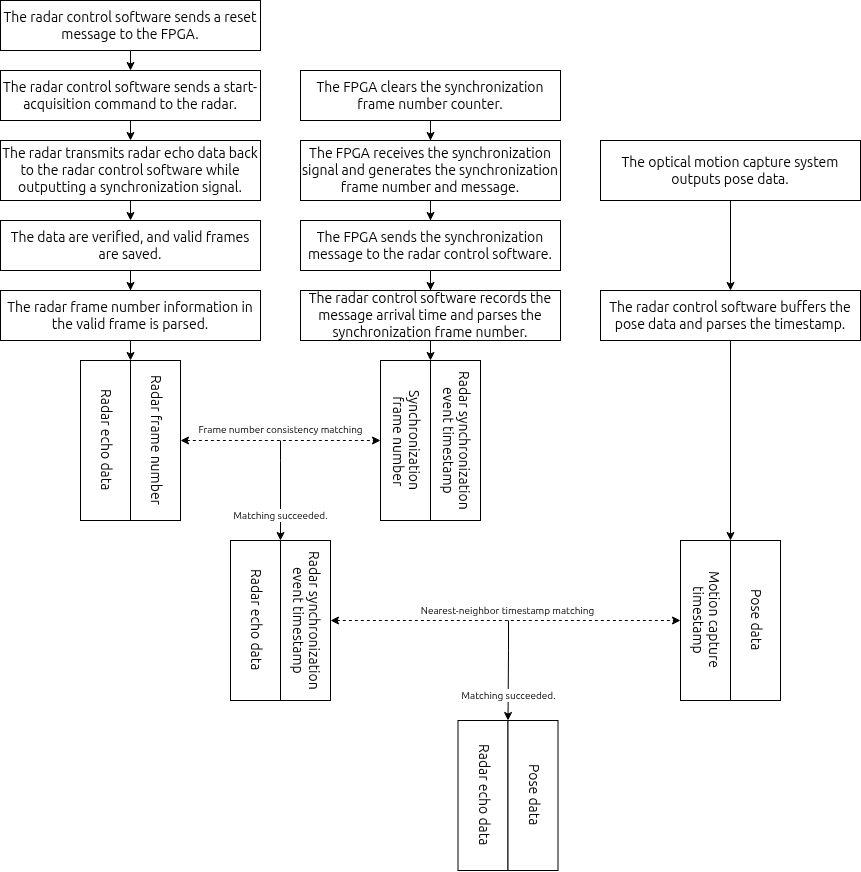
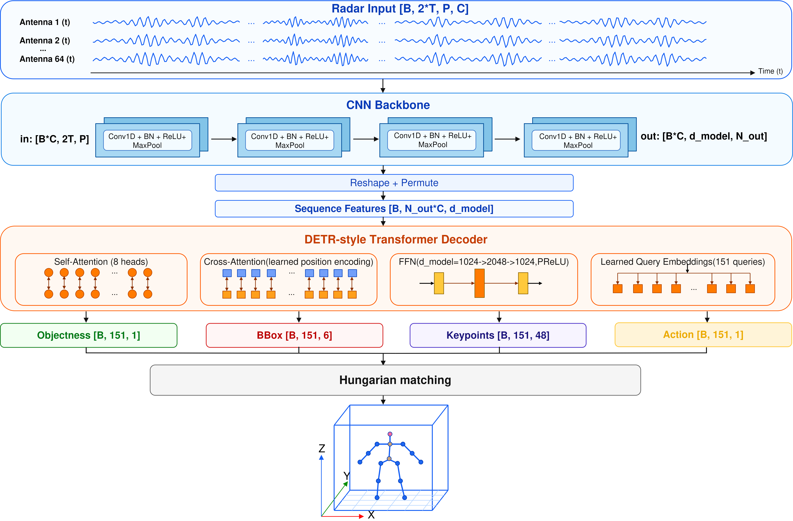
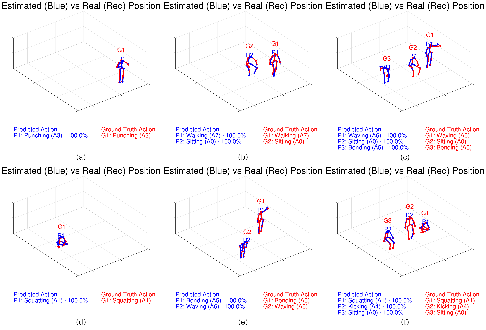
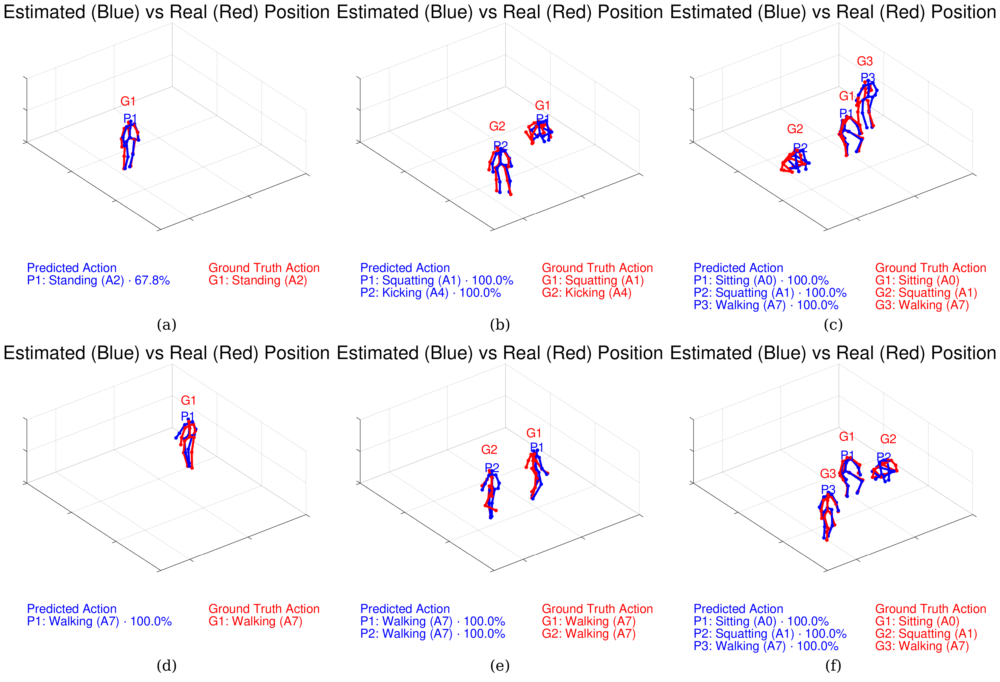
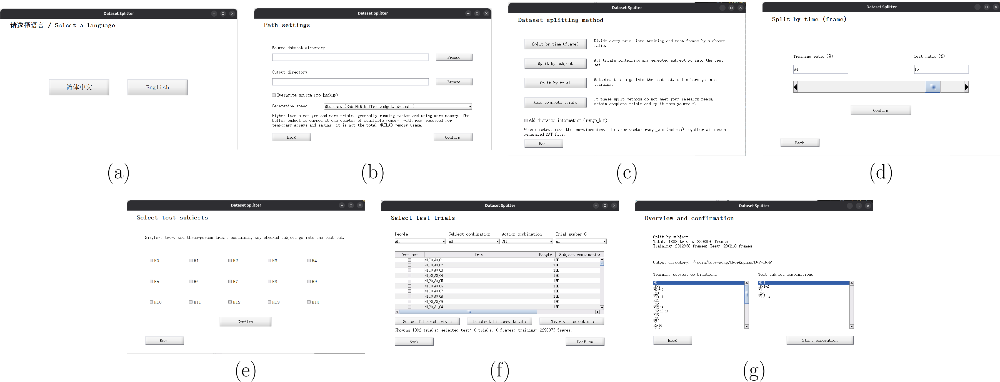
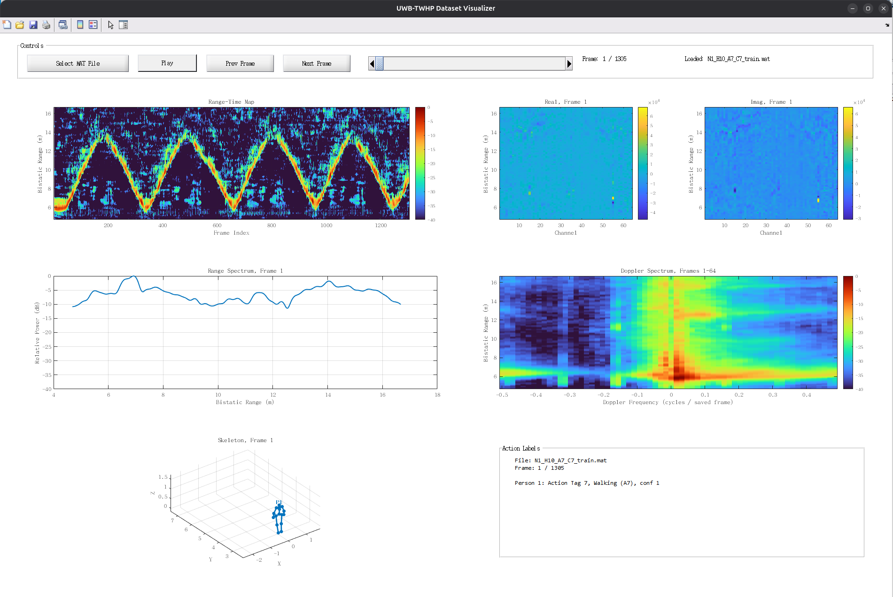

# UWB-TWHP 数据集中文说明

[English](README.md) | 简体中文

UWB-TWHP 是一个面向室内穿墙场景的超宽带雷达三维人体姿态数据集。数据由自研 UWB 穿墙雷达与光学动作捕捉系统同步采集，提供脉冲压缩后的雷达距离像、三维人体骨架标签和动作标签，可用于穿墙人体姿态重构、多人目标感知、动作分析和雷达信号处理研究。

## 数据集概览

| 项目 | 内容 |
| --- | --- |
| 传感器 | UWB 雷达，S 波段，中心频率 2.5 GHz，带宽 1 GHz，FMCW，8T8R TDM-MIMO，26 Hz |
| 参考标签 | NOKOV 光学动作捕捉系统输出的三维人体骨架 |
| 采集场景 | 室内穿墙场景，墙体厚度约 23.8 cm |
| 受试者 | 15 名志愿者，匿名编号为 H0-H14 |
| 人数场景 | 单人、双人、三人 |
| 动作类别 | 8 类常见动作 |
| 数据规模 | 1,882 个试次，划分后共 3,764 个 `.mat` 文件，2,293,076 帧雷达-姿态同步数据 |
| 数据大小 | 约 524.1 GB |
| 文件格式 | MATLAB v7.3 `.mat` |
| 默认划分 | 每个试次前 80% 帧为训练集，后 20% 帧为测试集（提供划分工具，可重新划分） |
| 配套资源 | 穿墙空背景数据、小规模非穿墙数据、数据集划分工具及可视化工具 |
| 开放协议 | CC BY 4.0 |

## 数据获取

数据集在 [Science Data Bank（科学数据银行）](https://www.scidb.cn/) 开放获取：[DOI：10.57760/sciencedb.41175](https://doi.org/10.57760/sciencedb.41175)，[CSTR：31253.11.sciencedb.41175](https://cstr.cn/31253.11.sciencedb.41175)。请通过该条目下载数据。

由于数据文件较大，建议使用 **FTP 下载**，网页下载速度可能存在波动。打开数据发布页，向下滚动至 **Data File Download**（数据文件下载）区域，点击 **FTP** 按钮，即可查看 FTP 主机地址、用户名、密码和端口，并使用这些信息配置 FTP 客户端进行下载。



数据集包含以下发布文件：

| 压缩包 | 内容 |
| --- | --- |
| `UWB-TWHP.7z.001`–`UWB-TWHP.7z.027` | 主穿墙数据集分卷压缩包，解压后约 524.1 GB |
| `UWB-TWHP_background.7z` | 穿墙空背景距离像；`part1`、`part2` 各含 29 个 `.mat` 文件，`file_background_lookup.csv` 提供试次与背景组的对应关系 |
| `UWB-TWHP_non-through-wall.7z` | 小规模非穿墙数据：`radardata/` 中有 126 个单人 `.mat` 文件，`background/` 中有 1 个空背景 `.mat` 文件 |
| `UWB-TWHP_Dataset_Splitter.zip` | MATLAB 数据集划分工具，支持重新划分、保留完整试次和追加距离坐标 |
| `UWB-TWHP_Dataset_Visualizer.zip` | MATLAB 可视化工具，用于查看雷达数据、姿态、动作和置信度标签 |

请将主数据集的 27 个分卷下载到同一目录，只需解压 `UWB-TWHP.7z.001`，解压软件会自动读取其余分卷并解压完整数据集，无需逐个解压。

相关代码仓库：

- 数据后处理与可视化代码：<https://github.com/Toby154/UWB-TWHP_Post-processing.git>
- 基线模型训练、测试和可视化代码：<https://github.com/Toby154/UWB-TWHP_baseline.git>

## 目录结构

数据按场景人数、训练/测试划分组织：

```text
UWB-TWHP/
├── 1/
│   ├── train/radardata/*.mat
│   └── test/radardata/*.mat
├── 2/
│   ├── train/radardata/*.mat
│   └── test/radardata/*.mat
└── 3/
    ├── train/radardata/*.mat
    └── test/radardata/*.mat
```



其中 `1`、`2`、`3` 分别表示单人、双人和三人场景。

## 文件命名规则

单人场景：

```text
N1_Hh_Aa_Cc_train.mat
N1_Hh_Aa_Cc_test.mat
```

双人场景：

```text
N2_Hh1-h2_Aa1-a2_Cc_train.mat
N2_Hh1-h2_Aa1-a2_Cc_test.mat
```

三人场景：

```text
N3_Hh1-h2-h3_Aa1-a2-a3_Cc_train.mat
N3_Hh1-h2-h3_Aa1-a2-a3_Cc_test.mat
```

命名含义：

- `N1`、`N2`、`N3`：场景人数。
- `H`：受试者编号，例如 `H0-1` 表示 H0 和 H1。
- `A`：动作编号，例如 `A2-3` 表示对应受试者分别执行 A2 和 A3。
- `C`：同一动作或动作组合在不同位置、路径下的重复采集编号。
- `train`、`test`：训练集或测试集。

多人场景中，受试者编号顺序和动作编号顺序严格对应。例如：

```text
N2_H0-1_A2-3_C1_train.mat
```

表示双人场景中，受试者 H0 执行动作 A2，受试者 H1 执行动作 A3，这是第 1 次重复采集的训练集文件。

## `.mat` 文件变量

每个 `.mat` 文件主要包含以下变量：

| 变量名 | 尺寸 | 含义 |
| --- | --- | --- |
| `action` | `n × 1 × f` | 动作标签，`n` 为人数，`f` 为帧数 |
| `joint` | `n × 48 × f` | 雷达坐标系下的三维人体姿态标签，单位为米 |
| `conf` | `n × 1 × f` | 目标存在置信标签；发布的主数据集中所有元素均为 `1` |
| `radar_data_real` | `512 × 64 × f` | 脉冲压缩后雷达距离像的实部 |
| `radar_data_imag` | `512 × 64 × f` | 脉冲压缩后雷达距离像的虚部 |

上表采用 MATLAB 维度顺序。雷达数组以单精度浮点数存储。通道顺序为 `c = 8 × (p - 1) + q`，其中 `p`、`q` 分别为从 1 开始的发射、接收天线编号，接收天线编号变化最快。

`joint` 的第二维共 48 个数，表示 16 个关节点的三维坐标：

- 第 `1-16` 位：16 个关节点的 `x` 坐标；
- 第 `17-32` 位：16 个关节点的 `y` 坐标；
- 第 `33-48` 位：16 个关节点的 `z` 坐标。

坐标含义：

- `x`：方位向；
- `y`：距离向；
- `z`：高度向。

雷达坐标系为右手坐标系，原点位于雷达阵列中心在地面上的垂直投影处。`x` 轴平行于墙体，`y` 轴正向由雷达指向受试者活动区，`z` 轴正向竖直向上。阵列中心坐标为 `(0, 0, 1.2)` m。不同采集批次的已发布姿态标签均已转换到这一统一坐标系。

16 个关节点顺序如下：

| 序号 | 关节点 |
| --- | --- |
| 1 | Head（头） |
| 2 | Neck（颈） |
| 3 | Spine（脊柱） |
| 4 | Spine3（脊柱上段） |
| 5 | LeftArm（左上臂） |
| 6 | LeftForeArm（左前臂） |
| 7 | LeftHand（左手） |
| 8 | RightArm（右上臂） |
| 9 | RightForeArm（右前臂） |
| 10 | RightHand（右手） |
| 11 | LeftUpLeg（左大腿） |
| 12 | LeftLeg（左小腿） |
| 13 | LeftFoot（左脚） |
| 14 | RightUpLeg（右大腿） |
| 15 | RightLeg（右小腿） |
| 16 | RightFoot（右脚） |



## 动作标签

| 动作编号 | 数字标签 | 动作名称 |
| --- | --- | --- |
| A0 | 0 | 坐姿（Sitting） |
| A1 | 1 | 下蹲（Squatting） |
| A2 | 2 | 站立（Standing） |
| A3 | 3 | 出拳（Punching） |
| A4 | 4 | 踢腿（Kicking） |
| A5 | 5 | 弯腰（Bending） |
| A6 | 6 | 挥手（Waving） |
| A7 | 7 | 行走（Walking） |

动作标签来自采集协议和目录命名规则，不是逐帧人工重新标注的动作类别。

每位受试者的动作标签在同一试次中保持不变。例如，弯腰试次中从站立、前屈到恢复站立的整个过程均标为 A5。需要区分逐帧动作状态的任务，应补充相应标注。

## 雷达处理与距离坐标

发布的复数距离像经过通道重组、快时间 FFT、逐通道距离偏移补偿、复数幅相校准和距离窗口裁剪生成。每个通道保留 3,940 个 ADC 采样点，处理时采用 102,400 点 FFT，再以两个 FFT 频点为步长保留 512 个距离单元。

两个采集批次采用了不同的距离起点：

| 距离轴文件 | 双程传播距离范围（m） | 保留距离轴的采样间隔（m） |
| --- | --- | --- |
| `range_axis_part1.csv` | 4.6875–16.6640625 | 0.0234375 |
| `range_axis_part2.csv` | 6.55078125–18.52734375 | 0.0234375 |

上述距离轴表示双程传播距离，姿态标签则表示雷达坐标系下的空间坐标。距离轴采样间隔与约 15 cm 的物理距离分辨率含义不同。

请使用后处理仓库中的 [`range_mapping/file_range_lookup.csv`](https://github.com/Toby154/UWB-TWHP_Post-processing/tree/main/range_mapping) 选择对应距离轴。其 `file_name` 字段为不含 `_train`、`_test` 和 `.mat` 的完整试次标识，例如 `N1_H0_A0_C1` 同时对应该试次的训练和测试文件。划分工具可将这一维距离向量作为 `range_bin` 写入生成的 `.mat` 文件。非穿墙数据使用 `range_axis_part2.csv`。

发布的距离像没有进行空背景相减或帧间对消。如需背景抑制，请使用单独提供的空背景数据，并通过 `file_background_lookup.csv` 选择相应的 `part1` 或 `part2` 组。同一试次的训练和测试文件使用相同背景组。

## Python 读取示例

由于数据保存为 MATLAB v7.3 `.mat` 文件，推荐使用 `h5py` 读取：

```python
import h5py

mat_path = "UWB-TWHP/1/train/radardata/N1_H0_A2_C1_train.mat"

with h5py.File(mat_path, "r") as f:
    print(list(f.keys()))

    # 按 h5py 维度顺序读取前 26 帧。
    action = f["action"][:26]                    # [帧数, 1, 人数]
    conf = f["conf"][:26]                        # [帧数, 1, 人数]
    joint = f["joint"][:26]                      # [帧数, 48, 人数]
    radar_real = f["radar_data_real"][:26]        # [帧数, 64, 512]
    radar_imag = f["radar_data_imag"][:26]
    radar_complex = radar_real + 1j * radar_imag

print(action.shape)
print(joint.shape)
print(radar_complex.shape)
```

对于这些 MATLAB v7.3 文件，`h5py` 返回的维度顺序与 MATLAB 相反：雷达数组为 `[f, 64, 512]`，姿态数组为 `[f, 48, n]`。基线模型在每个文件内部以步长 1 构建 26 帧窗口，将实部、虚部拼接并重排为 `[52, 512, 64]`；姿态、置信度和动作目标均取窗口末帧。训练加载器见 [`data/dataset.py`](https://github.com/Toby154/UWB-TWHP_baseline/blob/main/data/dataset.py)。

## 实验场地

实验在一间长 16.2 m、宽 7.7 m、高 3.3 m 的室内空旷房间中进行。为构建可控的穿墙感知场景，实验区域内搭建了一堵长度 5.8 m、厚度 23.8 cm 的普通红砖墙。

砖墙将空间分为雷达操作区和受试者活动区。雷达系统和采集计算机位于墙体一侧，受试者和光学动作捕捉系统位于墙体另一侧。采集时，雷达天线阵面紧贴墙壁，以减少雷达与墙体之间的空域传播距离，并增强墙后人体回波的可观测性。

受试者活动区内布置光学动作捕捉相机，并在地面铺设地毯和位置标记，用于提示受试者的站立点、运动路径和活动边界。在前述雷达坐标系下，受试者活动范围覆盖方位向约 -2.7 m 至 2.2 m、距离向约 1.6 m 至 8.4 m。



## 数据采集与同步说明

雷达以 26 Hz 帧率采集墙后人体回波，动作捕捉系统以 100 Hz 输出三维骨架。为了建立雷达数据和动作捕捉数据之间的帧级对应关系，采集系统使用雷达帧号、FPGA 同步脉冲计数和统一软件时间戳进行在线匹配。

同步流程如下：

1. 雷达控制软件向 FPGA 发送复位消息，并向雷达发送开始采集命令。
2. 雷达开始回传回波数据，同时在每帧采集开始时输出同步脉冲。
3. FPGA 接收同步脉冲，生成同步帧号和同步报文，并通过串口发送给雷达控制软件。
4. 采集软件解析雷达回波数据中的雷达帧号，并解析 FPGA 同步报文中的同步帧号。
5. 软件先根据帧号一致性，将雷达回波帧和同步事件绑定。
6. 光学动作捕捉系统同步输出姿态数据，采集软件缓存姿态数据并解析其时间戳。
7. 雷达数据帧率和动作捕捉帧率不同，因此软件使用最近邻时间戳匹配策略，为每帧雷达数据绑定时间上最接近的三维人体骨架帧。
8. 若最近邻时间差小于 38 ms，则匹配成功；否则该样本被判定为匹配失败并丢弃。



采集阶段仅保存完成匹配的有效样本，包括雷达帧号、脉冲压缩后的雷达距离像、匹配成功的三维骨架以及姿态帧时间戳。若丢包导致帧号或时间戳匹配无法完成，该样本不会被保存。最终发布的后处理 `.mat` 文件包含前述五个变量，不包含采集阶段的帧号和时间戳。

需要注意的是，雷达帧时间戳由采集软件在接收到 FPGA 串口同步报文时记录，而不是由 FPGA 本地硬件时钟直接生成。因此，该时间戳可能受到串口传输延迟和计算机系统调度延迟影响。数据集通过统一采集软件时钟、帧号一致性检查和时间门限约束来降低该影响。

最终发布数据为人工筛查和后处理后的 `.mat` 文件，不包含原始雷达回波文件和原始动作捕捉 JSON 文件。

## 基线模型与结果

数据集提供基于 CNN 和 DETR 风格 Transformer 的多人姿态估计与动作识别基线。CNN 提取雷达特征，Transformer 解码器预测目标置信度、三维包围盒、16 关节姿态和八类动作。该模型包含 161.02 M 个参数，单次前向计算量为 94.10 GFLOPs。



### 评测协议

- **按时间划分：** 每个试次前 80% 帧用于训练，后 20% 帧用于测试。这是相对简单的试次内评测，存在时间相关性带来的数据泄漏风险。
- **按受试者划分：** 所有包含 H1 的完整试次用于测试，包括单人 H1、双人 H0-1 和 H1-8、三人 H0-1-2 和 H1-8-14；其余试次用于训练。H1 不参与训练，与 H1 同场的其他受试者仍可能出现在训练试次中。
- **姿态与人员检测：** 目标置信度阈值为 0.9，三维包围盒非极大值抑制（NMS）的 IoU 阈值为 0.1。采用匈牙利匹配最小化 16 关节的平均关节位置误差（MPJPE），拒绝误差超过 500 mm 的匹配对。MPJPE 为雷达坐标系下的绝对三维关节误差，不进行平移、旋转或尺度对齐，对匹配成功的人员求平均；未匹配真值和预测分别计为漏检和虚警。
- **动作检测：** 按动作类别独立评估，以目标置信度与动作概率的乘积对预测降序排序，再与该类别中最近的未匹配真值人员配对，要求 MPJPE 不超过 500 mm。
- **统计方式：** 召回率、漏检率以真值人数为分母，精确率、虚警率以预测人数为分母；F1 为精确率与召回率的调和平均。总体结果汇总人员级误差和检测计数，不对各组分数直接取平均。

### 总体结果

以下各表中，MPJPE 的单位为 **mm**，其余数值均为**百分比**。

| 指标 | 按时间划分 | 按受试者划分（H1） |
| --- | --- | --- |
| 姿态 MPJPE（mm） | 61.682 | 130.51 |
| 人员漏检率 | 1.2819 | 4.3624 |
| 人员虚警率 | 3.0202 | 4.4854 |
| 人员召回率 | 98.718 | 95.638 |
| 人员精确率 | 96.98 | 95.515 |
| 人员 F1 | 97.841 | 95.576 |
| 动作漏检率 | 1.6125 | 32.671 |
| 动作虚警率 | 3.3449 | 32.757 |
| 动作召回率 | 98.387 | 67.329 |
| 动作精确率 | 96.655 | 67.243 |
| 动作 F1 | 97.514 | 67.286 |

### 分人数场景的姿态与人员检测结果

| 划分方式 | 场景 | MPJPE（mm） | 漏检率 | 虚警率 | 召回率 | 精确率 | F1 |
| --- | --- | --- | --- | --- | --- | --- | --- |
| 时间 | 单人 | 59.04 | 0 | 0.01865 | 100 | 99.981 | 99.991 |
| 时间 | 双人 | 67.576 | 2.0446 | 6.4903 | 97.955 | 93.51 | 95.681 |
| 时间 | 三人 | 57.267 | 1.3482 | 1.1953 | 98.652 | 98.805 | 98.728 |
| 受试者（H1） | 单人 | 113.32 | 0.42761 | 0.31149 | 99.572 | 99.689 | 99.63 |
| 受试者（H1） | 双人 | 135.06 | 3.5676 | 4.5798 | 96.432 | 95.42 | 95.924 |
| 受试者（H1） | 三人 | 131.25 | 5.8562 | 5.3792 | 94.144 | 94.621 | 94.382 |

### 分动作类别的姿态误差与动作 F1

| 动作 | 时间划分 MPJPE（mm） | 时间划分动作 F1 | 受试者划分 MPJPE（mm） | 受试者划分动作 F1 |
| --- | --- | --- | --- | --- |
| A0 坐姿 | 25.791 | 99.709 | 130.12 | 85.984 |
| A1 下蹲 | 31.509 | 99.902 | 169.24 | 89.554 |
| A2 站立 | 27.469 | 99.135 | 77.591 | 39.836 |
| A3 出拳 | 53.849 | 99.412 | 139.12 | 47.061 |
| A4 踢腿 | 58.86 | 98.912 | 102.07 | 56.896 |
| A5 弯腰 | 71.285 | 98.833 | 137.36 | 55.99 |
| A6 挥手 | 56.743 | 99.01 | 132.74 | 52.674 |
| A7 行走 | 123.52 | 91.353 | 152.89 | 84.936 |

### 可视化结果

动作混淆矩阵按行归一化，行表示真实动作，列表示预测动作。姿态图中蓝色为预测，红色为真值，动作标签显示在姿态图下方。

按时间划分：




按受试者划分：




### 代码与已有结果

[基线代码仓库](https://github.com/Toby154/UWB-TWHP_baseline) 提供训练和测试代码、模型权重、导出预测及 MATLAB 姿态与动作播放器。两种划分的已有结果分别位于 `results_under_the_time-based_split/` 和 `results_under_the_subject-based_split/`，对应权重由 Git LFS 管理。环境配置及评测步骤见该仓库的中英文 README。

复现以上结果时，请按上述评测协议汇总匹配人员误差并进行逐类别动作匹配。当前 Python `test.py` 导出的 `mean_mpjpe` 对逐样本均值再取平均；`matched_action_accuracy` 是姿态匹配人员中的动作分类准确率，与逐类别动作检测 F1 含义不同，不能直接使用这些摘要字段替代表中指标。

## 数据集工具

### 重新划分与追加距离坐标

解压 `UWB-TWHP_Dataset_Splitter.zip` 后，在 MATLAB 中运行 `START.m`。选择中文或英文、源数据集目录、独立输出目录及生成速度；速度等级越高，通常需要更多内存。

工具支持按可调帧数比例顺序划分、按选定受试者划分、按完整试次划分，以及保留完整试次供自定义划分。处理时先合并每个试次原有的训练和测试部分。按受试者划分时，只要某个试次包含任一选定测试受试者，就将该完整试次划入测试集。

勾选 **Add distance information (range_bin)**（追加距离信息）可将对应的双程传播距离向量写入每个生成文件。开始前核对试次与帧数统计及输出设置。**Overwrite source**（覆盖源数据）会替换源数据集且不保留备份；若需保留原数据，请使用独立输出目录。



### 查看数据文件

解压 `UWB-TWHP_Dataset_Visualizer.zip` 后，在 MATLAB 中运行 `START.m`。点击 **Select MAT File**（选择 MAT 文件）加载数据。界面显示雷达实部与虚部、三维姿态真值、时间-距离图、距离与多普勒频谱、动作标签和目标置信度标签，并提供播放与逐帧浏览功能。



上述工具的源码也可在[后处理仓库](https://github.com/Toby154/UWB-TWHP_Post-processing) 中找到，对应 `dataset_splitter.m` 和 `dataset_visualizer.m`。

## 使用建议

- 根据评测目标选择时间划分或 H1 受试者划分。默认试次内划分不能衡量对未见受试者的泛化能力。
- 自定义泛化实验可按受试者、动作、场景人数或完整试次重建划分，并明确报告具体方案；评估独立试次性能时，应保持试次完整。
- 多人场景中必须保持受试者顺序、动作顺序和 `action`、`joint` 中的人体顺序一致。
- 行走动作持续时间较长，帧数相对更多；做动作分类或均衡训练时需要注意类别分布。
- 所有数据来自同一室内环境，不能直接用于不同采集环境之间的泛化评测。
- 除部分行走交叉和遮挡外，采集时受试者间距通常至少为 1 m，复杂人体间遮挡和雷达目标混叠样本有限。
- 受试者均为健康成年人，数据不包含患者样本。
- 动作标签描述试次级活动；逐帧动作状态分析需要额外标注。

## 许可证

数据集按照 CC BY 4.0 协议共享和使用。相关代码按照 MIT 许可证开源。

## 引用

如果使用本数据集，请引用数据集条目及配套论文 *Through-wall 3D Human Pose Estimation Dataset Using UWB MIMO Radar*（《基于 UWB MIMO 雷达的穿墙三维人体姿态估计数据集》）。数据集引用格式如下：

> Dai, Y. et al. UWB-TWHP: through-wall 3D human pose estimation dataset using UWB radar. Science Data Bank (2026). <https://doi.org/10.57760/sciencedb.41175>

中文译名：UWB-TWHP：基于 UWB 雷达的穿墙三维人体姿态估计数据集。科学数据银行，2026 年。

论文最终出版信息将在确定后补充。
